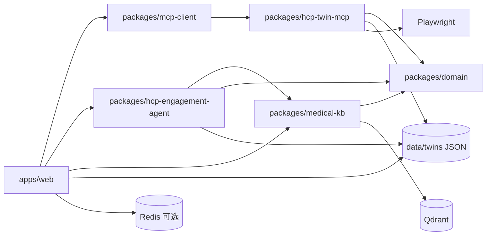

# 技术栈与开发依赖（HCP Engagement Assistant）

> Greenfield 规格。基准日 2026-07-16；与功能规格同步。  
> **整体架构**见 [`3.architecture.md`](./3.architecture.md)；产品见 [`1.product-definition.md`](./1.product-definition.md)。  
> **功能规格**：[`app/app-function-spec.md`](./app/app-function-spec.md) · [`mcp/mcp-function-spec.md`](./mcp/mcp-function-spec.md) · [`agent/agent-function-spec.md`](./agent/agent-function-spec.md) · [`rag/rag-function-spec.md`](./rag/rag-function-spec.md)  
> UI 离线原型：[`app/hca-ui-prototype.html`](./app/hca-ui-prototype.html) · 指南 [`6.ui-guideline.md`](./6.ui-guideline.md)

---

## 0. 初始化依赖（首次 clone 必做）

`npm install` 只安装 Node 依赖。**本地业务数据**不存 Postgres，统一落在仓库根目录的 **`data/`**（环境变量 `HCA_DATA_DIR`，默认 `./data`）。首次拉代码或新机器开发前，必须创建该目录树，否则 Twin 构建、Options 落盘、RAG 语料/manifest 写入会失败。

### 0.1 `data/` 用途

| 子目录 | 存储内容 | 写入方 |
|--------|----------|--------|
| `data/twins/` | HCP Virtual Twin、Insights JSON | `hcp-twin-mcp`、BFF、Agent（`doing_now`） |
| `data/engagements/` | Engagement Options、Assistant 会话 | `hcp-engagement-agent`、BFF |
| `data/tenants/` | 客户 SOP 元数据（可选，P2） | BFF / 租户配置 |
| `data/rag/corpus/` | RAG **主题语料**（academic / compliance / tenants） | `medical-kb` |
| `data/rag/` | ingest-manifest、eval-set | `medical-kb` |
| `data/qdrant/` | Qdrant 本地持久化卷 | Qdrant（**默认仅本机/内网**） |

向量索引在 **Qdrant**（本地）；结构化业务与语料在 **JSON/文件**。详见 §7、[`5.hcp-twin-data-dictionary.md`](./5.hcp-twin-data-dictionary.md)、[`rag/rag-function-spec.md`](./rag/rag-function-spec.md) §0.1。

### 0.2 创建目录（与 `npm install` 同级执行）

在仓库根目录执行（实现后也可封装为 `npm run setup:data`，由根 `package.json` 的 `postinstall` 调用）：

```bash
# 在仓库根目录，于 npm install 之后
mkdir -p data/twins \
         data/engagements \
         data/tenants \
         data/rag/corpus/academic \
         data/rag/corpus/compliance \
         data/rag/corpus/tenants \
         data/qdrant

# 可选：显式导出，与 web / MCP / Agent / medical-kb 一致
export HCA_DATA_DIR="${HCA_DATA_DIR:-$(pwd)/data}"
```

**推荐顺序（新开发者）：**

```bash
git clone <repo-url> hcp-engagement-assistant
cd hcp-engagement-assistant
npm install
npm run setup:data    # 实现后：等价于上述 mkdir；postinstall 可自动调用
cp .env.example .env  # 实现后
```

### 0.3 Git 与 `.gitignore`

- 运行时 JSON、语料、Qdrant 数据**不提交**；`.gitignore` 忽略 `data/**/*`，但保留 `data/**/.gitkeep`。
- 验收 fixture：`knowledge/hcp-twin/fixtures/` 或 `packages/domain/fixtures/`；勿把 live 数据当样例长期放在 `data/twins/`。
- 客户 SOP / 灌库语料**禁止**进 Git 或公开文档站。

### 0.4 健康检查

实现 `GET /api/health` 时须验证：`HCA_DATA_DIR` 可写；`twins/`、`engagements/`、`rag/`（含 `corpus/`）已创建；Qdrant 可达且绑定安全；MCP `health_check`；可选 Agent/LLM 探测。

---

## 1. 技术栈总览

### 1.1 应用与智能体

| 类别 | 技术 | 版本建议 | 说明 |
|------|------|----------|------|
| **前端框架** | Next.js（App Router） | 16.x | UI + BFF Route Handlers |
| **UI 库** | React | 19.x | 声明式 UI |
| **语言** | TypeScript | 5.9.x | 全栈类型安全 |
| **样式** | Tailwind CSS | 4.x | `@theme` 设计令牌 |
| **服务端状态** | TanStack React Query | 5.x | Twin 构建进度、Options、对话轮询 |
| **客户端状态** | Zustand | 5.x | 侧栏、筛选、Assistant 草稿等轻量 UI 状态 |
| **表单** | React Hook Form + Zod | 7.x / 4.x | HCP 身份锚点、Twin 触发、Options 反馈 |
| **ID** | @paralleldrive/cuid2 | 3.x | `hcpId`、`runId`、`sessionId` |
| **主数据存储** | **本地 JSON 文件** | — | Twin / Insights / Options / 会话；见 §7 |
| **向量库** | Qdrant | 1.12+ | academic + compliance 双索引 RAG |
| **队列 / 调度（可选）** | BullMQ + Redis | 5.x / 8.x | Twin 异步构建、热力监控、按需 ingest |
| **Agent 编排** | LangGraph.js | 0.2.x | 双路检索 → 合规 gate → 生成 |
| **LLM** | Qwen（OpenAI 兼容） | qwen-plus / qwen-max | Options 生成、对话修订、摘要 |
| **AI SDK** | openai | 6.x | DashScope 兼容端点 |
| **Embedding** | BGE-M3（本地或 API） | — | 稠密 + 稀疏；中英混合 |
| **Rerank** | bge-reranker-v2-m3 | — | Top-20 → Top-5 |
| **采集层** | **hcp-twin-mcp**（自研 MCP Server） | — | Twin 唯一采集入口 |
| **MCP 协议** | @modelcontextprotocol/sdk | 1.x | Server / Client |
| **HTTP 采集** | undici / native fetch | — | PubMed E-utilities、公开 API |
| **浏览器自动化** | Playwright Chromium | 1.55+ | **仅 hcp-twin-mcp 进程**内（医院页、会议页等） |
| **单元/集成测试** | Vitest + RTL | 4.x / 16.x | schema、RAG 契约、Agent tools、UI 组件 |
| **E2E** | Playwright | 1.61+ | Twin 流程、Options、Assistant 对话 |

### 1.2 洞察与 Options UI（已选型）

| 类别 | 技术 | 版本建议 | 许可证 | 用途 |
|------|------|----------|--------|------|
| **布局 / KPI** | `@tremor/react` | 3.18.x | Apache-2.0 | Insights 摘要卡、合规状态条 |
| **时间线 / 热力** | `echarts` + `echarts-for-react` | 5.6.x / 3.0.x | Apache-2.0 | 职业轨迹、活动热力时序 |
| **结构化列表** | `@tanstack/react-table` | 8.21.x | MIT | 论文列表、Options 对比表 |
| **对话 UI** | 自研 + `react-markdown` | 9.x | MIT | Assistant 消息、引用块 |
| **导出（P1）** | `packages/export-utils` | — | — | Options `.md` / `.pdf` 导出 |

### 1.3 合规与策略（非 npm，运行时加载）

| 资源 | 路径 | 用途 |
|------|------|------|
| `cn-hcp-pro` | 本仓 `.cursor/skills/cn-hcp-pro/`（亦可装至用户级 `~/.cursor/skills/`） | Engagement 策略人设与输出模板 |
| `cn-hcp-compliance` | 本仓 `.cursor/skills/cn-hcp-compliance/` | 生成后 Fail-fast 合规闸门 |
| `agent-builder` / `mcp-server-patterns` / `rag-implementation` | 本仓 `.cursor/skills/` | 实现时按技能约束架构与边界 |
| 术语表 | `knowledge/agent-hcp-engagement/glossary-abbreviations.md` | 缩写与监管用语统一 |

---

## 2. `apps/web` npm 依赖清单

Greenfield `apps/web` 的 **`dependencies`**（实现时写入 `apps/web/package.json`）：

```json
{
  "dependencies": {
    "next": "^16.2.0",
    "react": "^19.2.0",
    "react-dom": "^19.2.0",

    "@tremor/react": "^3.18.0",
    "echarts": "^5.6.0",
    "echarts-for-react": "^3.0.2",
    "@tanstack/react-table": "^8.21.0",
    "@tanstack/react-query": "^5.90.0",
    "react-markdown": "^9.0.0",

    "zustand": "^5.0.0",
    "react-hook-form": "^7.80.0",
    "@hookform/resolvers": "^5.0.0",
    "zod": "^4.4.0",
    "@paralleldrive/cuid2": "^3.3.0",

    "bullmq": "^5.0.0",
    "ioredis": "^5.6.0",

    "@hca/domain": "*",
    "@hca/mcp-client": "*",
    "@hca/medical-kb": "*",
    "@hca/hcp-engagement-agent": "*",
    "@hca/export-utils": "*"
  },
  "devDependencies": {
    "typescript": "^5.9.0",
    "tailwindcss": "^4.3.0",
    "@tailwindcss/postcss": "^4.3.0",
    "vitest": "^4.1.0",
    "@testing-library/react": "^16.3.0",
    "@testing-library/jest-dom": "^6.6.0",
    "@playwright/test": "^1.61.0",
    "@types/node": "^22.0.0",
    "@types/react": "^19.0.0",
    "@types/react-dom": "^19.0.0"
  }
}
```

> **npm workspaces**：根目录 `package.json` 声明 workspaces；包间引用写 `"*"`。  
> **Tremor + React 19**：根目录 `.npmrc` 设 `legacy-peer-deps=true`（与参考栈一致）。  
> **LLM / LangGraph**：`openai`、`@langchain/*` 装在 `packages/hcp-engagement-agent`（见 §8），**不**直接装进 `apps/web`；Web 经 `@hca/hcp-engagement-agent` 调用。

### 2.1 Next.js 约定

- 图表、对话、Options 编辑置于 Client Component（`"use client"`）；
- 大体积 `echarts` 对热力/时间线组件使用 `next/dynamic({ ssr: false })`；
- 前端 **只** 调 `/api/*`；禁止浏览器直连 MCP 或 Qdrant。

---

## 3. 仓库结构（目标）

```text
hcp-engagement-assistant/
├── apps/
│   └── web/                         # @hca/web · Next.js UI + BFF
├── packages/
│   ├── hcp-twin-mcp/                # @hca/hcp-twin-mcp · Twin 采集 MCP Server
│   ├── mcp-client/                  # @hca/mcp-client · BFF 侧 MCP 调用
│   ├── domain/                      # @hca/domain · Zod schema + 共享类型
│   ├── medical-kb/                  # @hca/medical-kb · ingest + 双索引检索
│   ├── hcp-engagement-agent/        # @hca/hcp-engagement-agent · 5 tools + LangGraph
│   └── export-utils/                # @hca/export-utils · Options 导出
├── data/                            # 本地持久化根（gitignore 运行时数据，保留 .gitkeep）
│   ├── twins/                       # Twin + Insights JSON
│   ├── engagements/                 # Options + 对话会话
│   ├── tenants/                     # 客户 SOP 元数据（可选）
│   ├── rag/
│   │   ├── corpus/                  # 主题语料 academic|compliance|tenants
│   │   ├── ingest-manifest.json
│   │   └── eval-set.json
│   └── qdrant/                      # Qdrant 本地卷（默认仅本机/内网）
├── knowledge/                       # 研究结论、术语表（已存在）
├── specs/                           # 权威规格（本文 + app/mcp/agent/rag）
├── .cursor/skills/                  # 本仓 Agent Skills
├── package.json
├── package-lock.json
├── .npmrc
└── docker-compose.yml               # web + hcp-twin-mcp + qdrant + redis（可选）
```

### 3.1 落地状态（2026-07-16）

| 项 | 状态 |
|----|------|
| 产品 / 业务 / RAG / Agent 知识库 | ✅ |
| npm workspaces + 各包脚手架 | ❌ 待建 |
| `hcp-twin-mcp` + 朱同玉 collector | ❌ P0 |
| `medical-kb` compliance 索引 | ❌ P0 |
| `hcp-engagement-agent` 5 tools | ❌ P0 |
| `apps/web` 四页 UI | ❌ P0 |
| `data/` JSON 读写层 | ❌ P0 |
| docker-compose | ❌ P1 |

---

## 4. 组件与依赖关系



| 包 | 依赖 | 禁止 |
|----|------|------|
| `apps/web` | `mcp-client`, `domain`, `medical-kb`, `hcp-engagement-agent`, `export-utils` | 直接 `playwright`、直连 Qdrant |
| `hcp-twin-mcp` | `@modelcontextprotocol/sdk`, `playwright`, `domain`, JSON store | `next`, UI 框架 |
| `medical-kb` | `@qdrant/js-client-rest`, embedding/rerank 客户端, `domain` | 业务 UI |
| `hcp-engagement-agent` | `medical-kb`, `domain`, `openai`, LangGraph | 爬虫、Playwright；浏览器直连 LLM |
| `mcp-client` | `@modelcontextprotocol/sdk` | `playwright` |

---

## 5. hcp-twin-mcp（Twin 采集 MCP）

### 5.1 职责

- 实现 Twin 相关 MCP Tools（身份锚点、分 collector 抓取、Insights 衍生）。
- Collector：职业轨迹（医院/大学页）、科研（PubMed / Scholar）、活动热力（会议、新闻，异步）。
- 输出写入 `data/twins/{hcpId}/`（见 §7.1）。

### 5.2 Tools（P0）

与 [`mcp/mcp-function-spec.md`](./mcp/mcp-function-spec.md) 对齐：

| Tool | 说明 |
|------|------|
| `resolve_hcp_identity` | 姓名 + 医院 + 科室 → URL 候选与 `hcpId` |
| `build_twin` | 触发全量/增量构建，返回 `runId` |
| `get_twin_status` | 构建进度 |
| `get_twin` / `get_insights` | 读本地 JSON |
| `tag_hcp` | 规则/覆盖写入 `profile.tags`（可在 resolve / Stage A 后重算） |
| `health_check` | 进程、`HCA_DATA_DIR` 可写、可选 Playwright 就绪；供 BFF `/api/health` |

### 5.3 运行方式

| 命令 | 场景 |
|------|------|
| `npm run dev:hcp-twin-mcp` | 开发：`stdio` 或 HTTP `:3200` |
| `npm run start:hcp-twin-mcp` | 生产：Streamable HTTP，供 `web` 内网调用 |

### 5.4 环境变量（MCP 进程）

| 变量 | 必填 | 说明 |
|------|------|------|
| `MCP_TRANSPORT` | 否 | `stdio` \| `http`（默认 `http`） |
| `MCP_PORT` | 否 | 默认 `3200` |
| `HCA_DATA_DIR` | 否 | 数据根目录，默认 `./data` |
| `TWIN_MODE` | 否 | `live`（默认）\| `mock`（CI fixture） |
| `CRAWLER_HEADLESS` | 否 | 生产 `true`；调试 `false` |
| `NCBI_API_KEY` | 否 | PubMed E-utilities 限速放宽 |
| `REDIS_URL` | 否 | 可选：构建任务队列 |

---

## 6. medical-knowledge-base（`packages/medical-kb`）

与 [`rag/rag-function-spec.md`](./rag/rag-function-spec.md) 对齐。

### 6.1 职责

- **双索引**：`academic_index` + `compliance_index`（见 `knowledge/rag-medical-knowledge-base/rag-architecture.md`）。
- 主题语料落 `data/rag/corpus/{academic,compliance,tenants}`，再 embed 入本地 Qdrant。
- Hybrid 检索：BGE-M3 dense + BM25 sparse → RRF → rerank。
- 按需 ingest：Twin `specialty/themes` 触发公开源拉取；合规种子自 `corpus/compliance` 预灌。
- **默认禁止**公网暴露 Qdrant、默认禁止托管向量 SaaS（须 ADR + `VECTOR_BACKEND`）。

### 6.2 对外 API（供 Agent / BFF）

| 方法 | 说明 |
|------|------|
| `retrieve_academic` | 专科 / 主题过滤检索 |
| `retrieve_compliance` | 合规检索（Agent 提案路径**强制**） |
| `ingest_on_demand` | 异步灌注；先落 corpus 再 upsert；写 manifest |
| `get_ingest_status` | 按 `jobId` 或 `specialty` 查进度 |
| `seed_compliance` | 自本地 corpus 灌合规种子 |
| `upsert_tenant_sop` | 租户 SOP → corpus + tenant 过滤字段 |
| `health` | Qdrant、双 collection、绑定是否安全 |

### 6.3 环境变量

| 变量 | 必填 | 说明 |
|------|------|------|
| `QDRANT_URL` | 是 | 默认 `http://localhost:6333`（回环或内网） |
| `VECTOR_BACKEND` | 否 | 默认 `qdrant-local`；改公有云须 ADR |
| `QDRANT_ALLOW_NON_LOCAL` | 否 | 严格模式下允许非本机 URL 的显式开关 |
| `EMBEDDING_MODEL` | 是 | 本地 BGE-M3 路径或内网 URL |
| `RERANK_MODEL` | 否 | bge-reranker 路径或服务 |
| `HCA_DATA_DIR` | 是 | 与 web / MCP 一致；语料在 `{HCA_DATA_DIR}/rag/corpus` |
| `NCBI_API_KEY` | 否 | 学术按需拉取限速 |

---

## 7. 数据存储（本地 JSON，不用 Postgres）

### 7.1 设计原则

| 原则 | 说明 |
|------|------|
| **文件即记录** | 每条业务实体一个 JSON 文件或一个目录树；无 SQL |
| **Schema 校验** | 读写经 `@hca/domain` 的 Zod schema；拒绝脏数据落盘 |
| **原子写入** | 先写 `*.tmp` 再 `rename`，避免半文件 |
| **单写者** | 同 `hcpId` 构建任务互斥（进程锁或 Redis 锁） |
| **可审计** | 保留 `source`、`as_of`、`version` 字段；Options 带 `compliance_refs[]` |
| **Git** | 运行时 `data/twins/**`、`data/engagements/**`、`data/rag/corpus/**`、`data/qdrant/**` gitignore；目录骨架用 `.gitkeep`；样例 fixture 放 `packages/domain/fixtures/` |

### 7.2 目录布局

```text
data/
├── twins/
│   └── {hcpId}/
│       ├── identity.json          # 用户录入 + 解析锚点
│       ├── twin.json              # 完整 Virtual Twin
│       ├── insights.json          # 衍生洞察（themes、兴趣、unmet need）
│       ├── career-timeline.json   # 可选：拆分大字段
│       ├── research.json          # 论文 / 基金 / 试验摘要
│       └── heatmap/
│           └── snapshots.json     # 活动热力时序
├── engagements/
│   └── {hcpId}/
│       ├── options/
│       │   └── {runId}.json       # propose_engagement_options 输出
│       └── sessions/
│           └── {sessionId}.json   # Assistant 多轮消息 + 修订历史
├── tenants/
│   └── {tenantId}/
│       └── sop.json               # 客户 SOP 元数据（P2）
└── rag/
    ├── corpus/                    # 主题语料（academic/compliance/tenants）；gitignore 内容
    │   ├── academic/
    │   ├── compliance/
    │   └── tenants/
    ├── ingest-manifest.json       # 已灌文档清单、版本、as_of
    └── eval-set.json              # RAG / Agent 回归用例（可选）
```

> 向量持久化见 §7.5 `data/qdrant/`。Qdrant **默认仅本机/内网**；知识语料与索引不进 Git、不默认公有云托管（见 [`rag/rag-function-spec.md`](./rag/rag-function-spec.md) §0.1）。

### 7.3 JSON 存储层（`packages/domain` 或 `packages/json-store`）

```typescript
// 示意 API
readJson<T>(path, schema: ZodSchema<T>): T
writeJson<T>(path, data: T, schema: ZodSchema<T>): void
listIds(dir: string): string[]
```

- BFF 与 MCP、Agent **共用**同一 `HCA_DATA_DIR` 挂载卷；
- 不做 Postgres / pgvector；向量仅存 **Qdrant**。

### 7.4 Redis（可选，非主存储）

| 用途 | 说明 |
|------|------|
| BullMQ | `twin-build`、`heatmap-poll`、`rag-ingest` |
| 分布式锁 | 多实例时同 `hcpId` 互斥写 JSON |
| SSE / 轮询 | `runId` 任务状态缓存 |

本地单机开发可先用内存队列 + 同步写 JSON；上线前再接 Redis。

### 7.5 Qdrant 卷

| 路径 | 内容 |
|------|------|
| `data/qdrant/` 或 Docker volume | `academic_index`、`compliance_index` 向量与 payload |

---

## 8. hcp-engagement-agent（`packages/hcp-engagement-agent`）

与 [`agent/agent-function-spec.md`](./agent/agent-function-spec.md)、[`agent/initial-prompt.md`](./agent/initial-prompt.md) 对齐。

### 8.0 包依赖（示意）

```json
{
  "dependencies": {
    "openai": "^6.39.0",
    "@langchain/langgraph": "^0.2.0",
    "@langchain/core": "^0.3.0",
    "@hca/medical-kb": "*",
    "@hca/domain": "*",
    "zod": "^4.4.0"
  }
}
```

### 8.1 P0 Capabilities（Tools · Options/Chat loop 内 5 个）

| Tool | 数据源 |
|------|--------|
| `get_twin_insights` | `data/twins/{hcpId}/insights.json`（含 `doing_now`） |
| `retrieve_academic` | `medical-kb` → Qdrant |
| `retrieve_compliance` | `medical-kb` → Qdrant（提案路径**不可跳过**） |
| `propose_engagement_options` | LLM + 上述上下文 → `data/engagements/.../options/` |
| `revise_engagement` | 读 session JSON，写回修订 |

另：**包级 API**（不占 Tool 名额）`synthesizeDoingNow` → 写 `insights.doing_now`（数字分身与 HCP 洞察同源）。

### 8.2 BFF 可调入口

| API | 说明 |
|-----|------|
| `synthesizeDoingNow` | 一句话洞察 |
| `proposeOptions` | 薄 LangGraph 提案主路径 |
| `chat` | `mode=open_chat` \| `revise_options` |
| `runComplianceGate` | 生成后 Fail-fast |
| `health`（可选） | LLM / data_dir / medical-kb |

### 8.3 LangGraph 薄编排（提案主路径）

```text
START → get_twin_insights
      → retrieve_academic ‖ retrieve_compliance
      → compliance_gate
      → generate_options（附 academic_refs + compliance_refs）
      → cn-hcp-compliance 检查（可选独立步）
      → END
```

Chat / 修订**不**强制重跑全图；模型决定是否再检索。

### 8.4 环境变量（LLM Provider 适配）

所有生成经 `LlmClient`；默认 `LLM_PROVIDER=qwen`。

| 变量 | 必填 | 说明 |
|------|------|------|
| `LLM_PROVIDER` | 否 | 默认 `qwen`；或 `openai_compatible` |
| `LLM_MODEL` | 否 | 默认 `qwen-plus` |
| `LLM_BASE_URL` | 否 | 通用兼容端点；`qwen` 可用 `DASHSCOPE_BASE_URL` |
| `LLM_API_KEY` | 条件 | 通用键；`qwen` 可用 `DASHSCOPE_API_KEY` |
| `DASHSCOPE_API_KEY` | 条件 | Qwen 默认路径推荐 |
| `DASHSCOPE_BASE_URL` | 否 | DashScope OpenAI 兼容地址 |
| `HCA_DATA_DIR` | 是 | 与 web / MCP 一致 |
| `LLM_TIMEOUT_MS` / `LLM_MAX_RETRIES` | 否 | 超时与重试 |

---

## 9. UI 应用（apps/web）

与 [`app/app-function-spec.md`](./app/app-function-spec.md) 对齐。

### 9.1 页面与 API

| 页面 | BFF 路由 | 后端 |
|------|----------|------|
| HCP Virtual Twin | `POST /api/twin/build`，`GET /api/twin/[hcpId]` | `mcp-client` → hcp-twin-mcp |
| HCP Insights | `GET /api/insights/[hcpId]`，`POST /api/insights/doing-now` | 读 `insights.json`；Agent `synthesizeDoingNow` |
| HCP Engagement Options | `POST /api/engagement/options`，合规检查可选 | `proposeOptions` / `runComplianceGate` |
| HCP Engagement Assistant | `POST /api/engagement/chat`（`mode`） | Agent `chat`（`open_chat` / `revise_options`） |

### 9.2 BFF 约定

- 长时间 Twin 构建返回 `runId`；React Query 轮询或 SSE；完成后可触发 `synthesizeDoingNow`。
- 对话：`mode=open_chat`（Agent Tab）与 `mode=revise_options`（一人一策页底）分会话；流式可选 SSE。
- 健康检查：`GET /api/health` → JSON 可写 + Qdrant/`medical-kb.health` + MCP `health_check` + 可选 Agent LLM。

### 9.3 环境变量（Web 进程）

| 变量 | 必填 | 说明 |
|------|------|------|
| `HCA_DATA_DIR` | 是 | 默认 `./data` |
| `MCP_URL` | 生产是 | 例 `http://hcp-twin-mcp:3200` |
| `QDRANT_URL` | 是 | 供 medical-kb（BFF 侧库调用）；浏览器禁止直连 |
| `REDIS_URL` | 否 | 异步任务 |
| `LLM_*` / `DASHSCOPE_*` | 条件 | 若 BFF 同进程调 Agent，与 §8.4 一致；Key **仅服务端** |

---

## 10. 外部服务

| 服务 | 用途 | 配置 |
|------|------|------|
| **DashScope Qwen**（默认）或其它 OpenAI 兼容网关 | Options、对话、doing_now、摘要 | `LLM_*` / `DASHSCOPE_*` |
| **PubMed E-utilities** | 论文与 MeSH | `NCBI_API_KEY`（可选） |
| **Qdrant（本地）** | 向量检索 | `QDRANT_URL`；默认非公网 |
| **Embedding / Rerank** | 自托管或内网 API | `EMBEDDING_*`、`RERANK_*` |

公开网页（医院官网、会议站、Scholar）经 **hcp-twin-mcp + Playwright/fetch** 采集，无第三方「医生数据 API」依赖。向量默认**不**用公有云 SaaS。

---

## 11. 开发与测试

### 11.1 本地启动

```bash
npm install

# 首次 / 新环境：创建本地存储目录（见 §0.2）
mkdir -p data/twins data/engagements data/tenants \
         data/rag/corpus/academic data/rag/corpus/compliance data/rag/corpus/tenants \
         data/qdrant
export HCA_DATA_DIR="${HCA_DATA_DIR:-$(pwd)/data}"

# 终端 1：Qdrant（挂载 data/qdrant）
# 开发：-p 6333:6333 仅本机访问即可；生产 compose 勿把 6333 发布到公网
docker run -d -p 127.0.0.1:6333:6333 -v $(pwd)/data/qdrant:/qdrant/storage qdrant/qdrant:v1.12.0

# 终端 2：hcp-twin-mcp
npm run dev:hcp-twin-mcp

# 终端 3：Web
npm run dev

# 可选：Redis
docker run -d -p 6379:6379 redis:8
```

### 11.2 测试策略

| 层级 | 工具 | 范围 |
|------|------|------|
| Domain schema | Vitest | Twin / Insights / Options Zod 往返 |
| JSON store | Vitest | 原子写、并发锁、损坏文件恢复 |
| Collector 契约 | Vitest + fixture HTML/JSON | 职业/科研解析纯函数 |
| MCP Tool | Vitest + `TWIN_MODE=mock` | Tool I/O 契约 |
| medical-kb | Vitest | 检索过滤、合规强制命中 |
| Agent | Vitest | 5 tools、`synthesizeDoingNow`、chat mode、合规 gate、引用字段 |
| UI | Vitest + RTL | 四页关键路径 |
| E2E | Playwright | 朱同玉样例：建 Twin → Options → 对话修订 |

### 11.3 质量门禁

```bash
npm run test          # 单元 + 契约
npm run test:e2e      # 核心用户路径
npm run build         # web + hcp-twin-mcp + agent 包构建通过
```

---

## 12. 生产部署（Docker Compose 摘要）

| 服务 | 基础镜像 | 关键挂载 / 环境 |
|------|----------|-----------------|
| `web` | `node:22-alpine` + Next standalone | `HCA_DATA_DIR` 卷、`MCP_URL`、`QDRANT_URL` |
| `hcp-twin-mcp` | `node:22` + Playwright | `HCA_DATA_DIR` 卷、`TWIN_MODE=live` |
| `qdrant` | `qdrant/qdrant` | `data/qdrant` 卷；**不**将 6333 暴露公网 |
| `redis` | `redis:8-alpine` | 可选队列 |
| `nginx` | `nginx:alpine` | TLS → `web:3000` |

**无 Postgres 容器。**

---

## 13. 与参考栈（social-media-mkt）差异

| 项目 | 参考栈 | 本仓（HCP Engagement Assistant） |
|------|--------|----------------------------------|
| 产品域 | 自媒体营销洞察 | 药企 HCP Twin + Engagement |
| 采集 MCP | socia-media-mkt（四平台登录） | **hcp-twin-mcp**（公开医学信息） |
| 主存储 | PostgreSQL `mia` | **本地 JSON** `data/twins`、`data/engagements` |
| 向量库 | 无 | **Qdrant** 双索引 RAG |
| 智能体 | insight-engine 摘要 | **hcp-engagement-agent** + LangGraph + 合规 gate |
| 核心 UI | 搜索 / Watch / 报表 | Twin → Insights → Options → Assistant |
| Playwright | 平台登录与搜索 | 医院/会议页等 **仅 Twin MCP** |
| 合规 | 内容平台规则 | **cn-hcp-compliance** + RDPAC / 医药代表办法 |

---

## 14. P0 交付依赖顺序

| 顺序 | 交付物 | 验收 |
|------|--------|------|
| 0 | **`data/` 目录骨架** + `npm run setup:data`（或 postinstall） | clone 后一键可写 Twin/Options |
| 1 | `packages/domain` — Zod schema + JSON 读写 | 朱同玉 fixture 往返 |
| 2 | `packages/hcp-twin-mcp` — identity + career + PubMed collector | mock + live 产出 `twin.json` |
| 3 | `packages/mcp-client` | BFF 可调 Tool |
| 4 | `packages/medical-kb` — compliance 索引 + 检索 | RDPAC 条款可引用 |
| 5 | `packages/hcp-engagement-agent` — 5 tools + `synthesizeDoingNow` + LlmClient | 朱同玉 Options + doing_now |
| 6 | `apps/web` — 四页 UI + BFF | 端到端演示 |
| 7 | `medical-kb` academic 按需 ingest | 话题对齐 Twin themes |
| 8 | Redis + 热力异步 + docker-compose | P1 |

**验收用例**：复旦大学附属中山医院朱同玉教授（见 [`1.product-definition.md`](./1.product-definition.md)）。

---

## 15. 参考

- 产品：[`1.product-definition.md`](./1.product-definition.md)
- 业务：[`2.business-context.md`](./2.business-context.md)
- 架构：[`3.architecture.md`](./3.architecture.md)
- Web：[`app/app-function-spec.md`](./app/app-function-spec.md) · 原型 [`app/hca-ui-prototype.html`](./app/hca-ui-prototype.html)
- MCP：[`mcp/mcp-function-spec.md`](./mcp/mcp-function-spec.md)
- Agent：[`agent/agent-function-spec.md`](./agent/agent-function-spec.md) · [`agent/initial-prompt.md`](./agent/initial-prompt.md)
- RAG：[`rag/rag-function-spec.md`](./rag/rag-function-spec.md) · [`knowledge/rag-medical-knowledge-base/rag-architecture.md`](../knowledge/rag-medical-knowledge-base/rag-architecture.md)
- Twin 数据源：[`knowledge/mcp-hcp-virtual-twin/data-sources-zhu-tongyu.md`](../knowledge/mcp-hcp-virtual-twin/data-sources-zhu-tongyu.md)
- 缩写：[`knowledge/agent-hcp-engagement/glossary-abbreviations.md`](../knowledge/agent-hcp-engagement/glossary-abbreviations.md)
