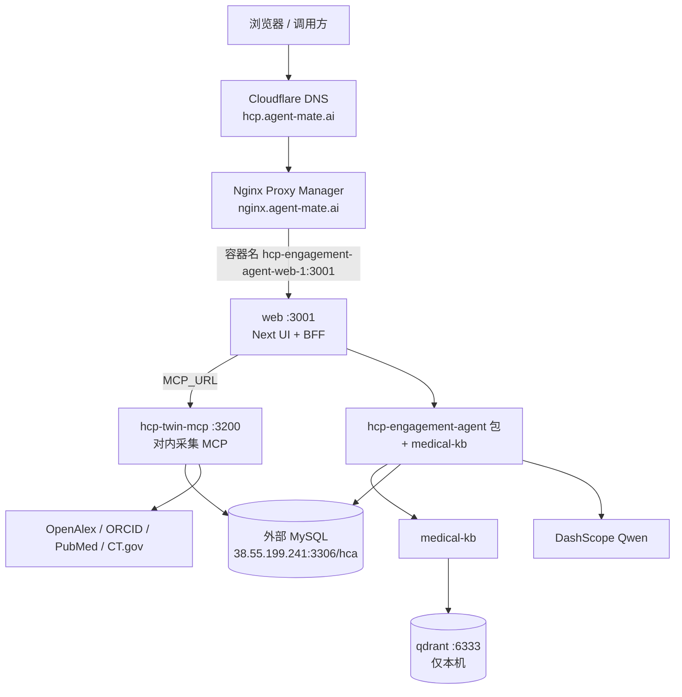

# 上线部署手册 — HCP Engagement Assistant

> **as_of**：2026-10-22
> **信息源**：`~/code/release-bot`（半自动发布手册 + 野草云3 实机清单 as_of 2026-08-20）+ 本仓库 main 分支制品（compose / Dockerfile / CI）。
> **架构**：[spec1.0/3.architecture.md](./spec1.0/3.architecture.md) · 2.0 增量：[architecture.md](./architecture.md)
> **安全基线**：本文件不写数据库口令、API Key、PAT；密码只在节点 `.env` / Portainer env / 本机密钥库。

---

## 1. 生产环境现状（实机盘点）

生产已部署于 **野草云3** 节点，经 release-bot 半自动流程（Portainer + GHCR + NPM + Cloudflare）维护。

| 项 | 生产事实 |
| --- | --- |
| 节点 | 野草云3 · `38.55.192.140` · Ubuntu · 4 vCPU / 7.8 GiB |
| 编排 | Portainer `https://portainer.agent-mate.ai` · Stack **`hcp-engagement-agent`**（stack id 12） |
| Compose 工作目录 | `/data/compose/12/`（bind：`/data/compose/12/data` → `/data`；`…/data/qdrant` → `/qdrant/storage`） |
| 共享网络 | `portainer_network`（external；**禁止删建**） |
| 公网域名 | `https://hcp.agent-mate.ai`（Cloudflare → NPM → web 容器） |
| NPM 入口 | `https://nginx.agent-mate.ai` · Host `hcp.agent-mate.ai` → **容器名** `hcp-engagement-agent-web-1` : `3001` |
| 主库 | 外部 MySQL `38.55.199.241:3306` / 库名 **`hca`**（ADR-005：运行时唯一主库；密码仅在节点 `.env`） |
| 镜像 | `ghcr.io/ethanhuangcst/hcp-engagement-agent/{web,hcp-twin-mcp}:<IMAGE_TAG>`；边缘只 pull，不 build |
| 镜像体积参考 | web ~428MB · hcp-twin-mcp ~1.19GB |

### 1.1 服务表（现网）

| Service | 容器 | 镜像 | 容器端口 | 主机端口 | 公网 | 职责 |
| --- | --- | --- | --- | --- | --- | --- |
| web | `hcp-engagement-agent-web-1` | `…/web:latest` | 3001 | 3001 | 是（经 NPM） | Next UI + BFF |
| hcp-twin-mcp | `hcp-engagement-agent-hcp-twin-mcp-1` | `…/hcp-twin-mcp:latest` | 3200 | 3200 | 否 | 对内采集 MCP |
| hcp-engagement-mcp（2.0 上线后） | `hcp-engagement-agent-hcp-engagement-mcp-1` | `…/hcp-engagement-mcp:<tag>` | 3300 | `127.0.0.1:3205` | 否 | 对外 MCP 八工具（[1021 上线手册](./go-live/1021/go-live-instruction.md) Phase 4 起存在） |
| qdrant | `hcp-engagement-agent-qdrant-1` | `qdrant/qdrant:v1.14.1` | 6333 | `127.0.0.1:6333` | 否 | 向量库 |

内网互访（Docker DNS）：`MCP_URL=http://hcp-twin-mcp:3200`；`QDRANT_URL=http://qdrant:6333`。

### 1.2 同节点共存应用（防误伤清单）

`mypoke-trade`（`mypoke.trade` · 3002/3201/6335）、`kb-agent`（`kb.agent-mate.ai` · 3006/3202/3203/6336）、`places-agent`（`places.agent-mate.ai` · 3007）。规则见 release-bot `knowledge/09-isolation-safety.md`：只改本 Stack / 本 NPM Host / 本 DNS；发布后抽查 ≥1 个既有应用。

---

## 2. 运行时架构（生产流量路径）

2.0 新增服务 `hcp-engagement-mcp`（对外 MCP 八工具）见 §6。

---

## 3. 仓库侧前置条件（发布前必须齐备）

| # | 工件 | 位置 | 状态 |
| --- | --- | --- | --- |
| 1 | 生产 compose（仅 `image:`，external `portainer_network`） | `docker-compose.yml` | **main 分支已有**；mvp4 分支缺失，须先合回（见 §6.3 阻塞项） |
| 2 | Dockerfile | `docker/Dockerfile.web` · `docker/Dockerfile.mcp` | main 已有；mvp4 缺失 |
| 3 | CI → GHCR | `.github/workflows/docker-build.yml`：push `main` 或 tag `v*` → `latest` / `sha-*` / `semver` | main 已有；mvp4 缺失 |
| 4 | Env 模板 | `.env.example` | 已有；示例连接串已按 ADR-005 更新为 MySQL |
| 5 | 迁移命令 | `npm run db:migrate`（MySQL 建表）；`db:migrate:pg-to-mysql`（首次迁库）；`db:migrate:mysql-to-mysql`（换主机） | 已有 |
| 6 | 2.0 新增 | `docker/Dockerfile.mcp2`（hcp-engagement-mcp 镜像）+ compose 新服务 + CI matrix 追加 | **未建**（mvp4 分支，2026-10-22 实查）；2.0 首次发布的前置工作，执行件 [1021 上线手册](./go-live/1021/go-live-instruction.md) Phase 0.2–0.4，跟踪 [REL2-01 MVP2 上线](./product-backlog.md#pb-18) |

---

## 4. 环境变量（Portainer Stack env / 节点 `.env`）

| Name | Required | 说明 |
| --- | --- | --- |
| `DATABASE_URL` | yes | `mysql://<DB_USER>:<密码>@38.55.199.241:3306/hca`；密码 URL 编码；只写节点 env，不进 Git |
| `IMAGE_TAG` | yes | 必须是 GHCR **已存在** tag（`sha-*` / `v*` / `latest`）；分支名 `main` 不是 tag |
| `MCP_URL` | yes | `http://hcp-twin-mcp:3200`（容器名） |
| `MCP_TRANSPORT` / `MCP_PORT` | yes | `http` / `3200` |
| `TWIN_MODE` | yes | `live`；`mock` 仅 CI 且须 `ALLOW_TWIN_MOCK=1` |
| `QDRANT_URL` | yes | `http://qdrant:6333` |
| `HCA_DATA_DIR` | yes | `/data`（bind 卷） |
| `EMBEDDING_MODEL` / `HF_ENDPOINT` / `TRANSFORMERS_REMOTE_HOST` / `RERANK_DISABLE` | 建议 | 首次拉模型走 `https://hf-mirror.com`；生产可 `RERANK_DISABLE=true` |
| `LLM_PROVIDER` / `LLM_MODEL` / `DASHSCOPE_API_KEY` | yes* | LLM 能力需要；`*` 无 Key 时规则降级可用，但一人一策质量门禁要求 live 抽检 |
| `TWIN_REFRESH_CRON`（2.0） | no | 未设 = TWIN2-01 关闭；设如 `"0 2 * * *"` 开启定时刷新 |
| `TWIN_REFRESH_TTL_HOURS`（2.0） | no | 默认 24 |
| `MCP2_PORT`（2.0） | no | 对外 MCP 端口（建议 `3300`）；传输为 Streamable HTTP（ADR-008，无 `MCP2_TRANSPORT`） |

---

## 5. 日常发布流程（半自动，对齐 release-bot Step 0–8）

### Step 0 — 发布前检查

1. 确认仓库 `ethanhuangcst/hcp-engagement-agent`、发布分支或 tag → `<IMAGE_TAG>`。
2. 确认目标节点：野草云3（`38.55.192.140`）。
3. 确认节点 env 的 `DATABASE_URL` 指向本应用库 `hca`（勿复制他应用连接串）。
4. 确认服务清单：web / hcp-twin-mcp / qdrant（+ 2.0 起 hcp-engagement-mcp）。
5. 记下当前 Stack 的 `IMAGE_TAG`（回滚用）；不动其他 Stack。

### Step 1 — CI 构建推送（有代码变更时）

1. 合并代码到 `main`（或打 `v*` tag）→ GitHub Actions `docker-build.yml` 自动构建推送 GHCR。
2. 在 Actions / GHCR Packages 确认本次 `IMAGE_TAG` 构建成功。
3. **不在边缘机 build 应用镜像**（ADR-006）。

完成标准：GHCR 可见目标 tag。

### Step 2 — 数据库：先连通，再按需迁移

1. 节点上确认可连 `38.55.199.241:3306/hca`。
2. 日常发布（结构未变）跳过迁移；结构变更则先备份 `hcp_twins` / `hcp_insights` / `engagement_options` / `chat_sessions`，再执行 `npm run db:migrate`。
3. 迁移范围仅限本应用库 `hca`；禁止对共享实例跑会影响他库的脚本。

### Step 3 — Portainer 部署

1. 打开 `https://portainer.agent-mate.ai` → 本机 Endpoint。
2. **二次确认**打开的是 Stack `hcp-engagement-agent`（不是 mypoke / kb / places）。
3. 更新 env 的 `IMAGE_TAG` → **Update stack**；Portainer 对 `latest` 常不重新 pull：用 **Recreate + Pull**，或改用明确 `sha-*` tag。
4. 确认网络为已存在的 `portainer_network`（不要删网）。
5. 检查三个服务 running、日志无连接错误；扫一眼其他 Stack 未批量 Restarting。

### Step 4 — Cloudflare / NPM（仅首次或域名变更）

现网已配好，日常发布**跳过本步**。首次配置事实：

- Cloudflare：zone `agent-mate.ai`，`hcp` A 记录 → `38.55.192.140`。
- NPM：Host `hcp.agent-mate.ai` → Forward `http://hcp-engagement-agent-web-1:3001`（容器名 + **容器**端口）。
- 现网注意：NPM 上有两条 hcp Host（#1 上游是 IP，#2 是容器名）；清理时只删 IP 那条，保留容器名那条，勿碰其他域名。
- Stack recreate 后：对本应用 NPM Host **再点一次 Save**，再验健康检查。

### Step 5 — 冒烟

| 检查 | 通过标准 |
| --- | --- |
| `https://hcp.agent-mate.ai/` | HCP 数字分身列表可打开 |
| `GET /api/health` | MySQL 可达、MCP ping ok（或显式 degraded 项有说明） |
| 核心路径 | 新增（消歧→确认保存）→ 构建情报（进度推进）→ 洞察八块 → 一人一策生成 → 合规检查 |
| 对内 MCP | `GET http://38.55.192.140:3200/health`（或容器内 `curl hcp-twin-mcp:3200/health`）`twin_mode=live` |
| 对外 MCP（2.0 起） | 节点上 `GET http://127.0.0.1:3205/health` `{"ok":true}` |
| RAG | 合规检索命中含 `clause_id`（有灌库时） |

本地 live 脚本（Qdrant + MySQL 实调验收）放仓库根，命名 `.tmp-*.mts`，用 `npx tsx` 从仓库根跑；验收后删除（`.gitignore` 已覆盖 `.tmp-*`）。

### Step 6 — 共存抽查（必做）

从 §1.2 选 ≥1 个既有应用（如 `https://places.agent-mate.ai` 或 `https://kb.agent-mate.ai`）验证可用；确认其他 Stack 无异常。

---

## 6. 2.0 上线增量

### 6.1 新服务 `hcp-engagement-mcp`

| 项 | 设计 |
| --- | --- |
| 镜像 | `ghcr.io/ethanhuangcst/hcp-engagement-agent/hcp-engagement-mcp:<IMAGE_TAG>`（CI matrix 追加，前置条件 §3-6） |
| 容器端口 | `3300` |
| 主机端口 | `127.0.0.1:3205→3300`（2026-10-21 实测 3204 已被同节点他应用占用，改 3205；loopback-only，同 qdrant 模式） |
| 公网 | 默认**不**开 Cloudflare（2.0 不做鉴权，仅内网/节点可达）；如需给外部宿主用，走 SSH 隧道或运维批准的专用入口 |
| env | 同 §4（共享 `DATABASE_URL`），`MCP2_PORT=3300`（仅 Streamable HTTP，ADR-008） |
| 健康 | `GET :3300/health` |

本地开发：仓库根执行 `npm run dev:hcp-engagement-mcp`（Streamable HTTP :3300，ADR-008；无 stdio 模式）。

### 6.2 TWIN2-01 定时刷新

- Stack env 增加 `TWIN_REFRESH_CRON`（建议凌晨低峰）开启；未设 = 关闭，行为与 1.0 一致。
- 上线后次日核对：stderr 日志有本轮刷新记录；`hcp_twins.as_of` 更新；外网 API 无配额告警。

### 6.3 阻塞项（发布 2.0 镜像前必须完成）

| # | 事项 | 说明 |
| --- | --- | --- |
| 1 | 把 `docker-compose.yml` / `docker/` / `.github/workflows/` 从 main 合回 mvp4 | mvp4 分支缺这三样（2026-10-22 实查），CI 无法出制品 |
| 2 | 新增 `docker/Dockerfile.mcp2`（或等价）+ compose 新服务 + CI matrix | 对应 [architecture.md](./architecture.md) §10 |
| 3 | NPM / 端口决策 | 已决：主机端口 `127.0.0.1:3205→3300`，不对公网开；若对外 MCP 需被节点外宿主直连，先由运维定入口方式（默认仅内网） |

> 跟踪：以上三项归 [REL2-01 MVP2 上线](./product-backlog.md#pb-18)（Sprint 2，SBI task-02）；执行细节见 [1021 上线手册](./go-live/1021/go-live-instruction.md)。工作区提交（原阻塞 1）与生产 Qdrant 回灌（原数据阻塞）已于 2026-10-21 完成。

---

## 7. 回滚

1. **只**回滚本 Stack：`IMAGE_TAG` 改回发布前记录的 tag（优先 `sha-*`）→ Update + Re-pull。
2. 确认三服务恢复 running；本应用冒烟 + 抽查 1 个既有应用。
3. **不要**为修本应用重启无关 Stack、`portainer_network` 或 Portainer 本身。
4. 数据库：只升镜像未迁库时回滚镜像即可；已迁移的先评估脚本可逆性，必要时用 Step 2 的备份恢复。

## 8. 故障排查速查

| 现象 | 先查 |
| --- | --- |
| 域名 502 | web 容器是否 running；NPM 上游是否 `hcp-engagement-agent-web-1:3001`；是否在 `portainer_network` |
| 容器反复重启 | 日志；`DATABASE_URL` 是否错误或密码未 URL 编码（含 `@` 等特殊字符必须编码） |
| 镜像拉不下来 | GHCR 是否有该 tag；PAT `read:packages` 是否有效（私有包） |
| 更新后仍是旧版本 | Portainer Update 未重新 pull → Recreate + Pull 或换 `sha-*` |
| 能连库但业务不可用 | 是否漏跑 `db:migrate` |
| 构建情报无进度 | 对内 MCP `:3200/health`；`MCP_URL` 是否容器名 |
| 一人一策降级为规则稿 | `DASHSCOPE_API_KEY` 是否配置；LLM 连通性 |

## 9. 运维红线（摘要）

- 只改 Stack `hcp-engagement-agent`、本应用 NPM Host、本应用 DNS；禁止删建 `portainer_network`。
- `IMAGE_TAG` 必须是 GHCR 已发布 tag；不用分支名。
- 密钥只进节点 env / Portainer env；进过聊天或截图的密钥立即轮换。
- Agent / MCP / Qdrant 主机端口不对公网开 Cloudflare（Qdrant 仅 `127.0.0.1`）。
- 发布后必做共存抽查。

> **安全提示**：本仓库在 GitHub 为 Public。§1 的节点 IP / 域名 / 库主机为运维事实而非凭据，但若不希望公开基础设施信息，可改为占位符并把实值留在 release-bot 私有库；需要时说一声即可替换。

## 10. 相关文档

| 文档 | 内容 |
| --- | --- |
| [architecture.md](./architecture.md) | 2.0 架构与 hcp-engagement-mcp / TWIN2-01 设计 |
| [spec1.0/4.install-dependencies.md](./spec1.0/4.install-dependencies.md) | 依赖、env、`data/` 初始化 |
| [spec1.0/7.test-strategy.md](./spec1.0/7.test-strategy.md) | 测试门禁与 SMART DoD |
| release-bot `knowledge/03-semi-auto-release.md` · `09-isolation-safety.md` · `06-rollback.md` | 发布 / 隔离 / 回滚通用手册 |
| release-bot `svr_hk_vps_3/hk_vps_3_setting.md` | 野草云3 实机资源清单（刷新以实机为准） |
